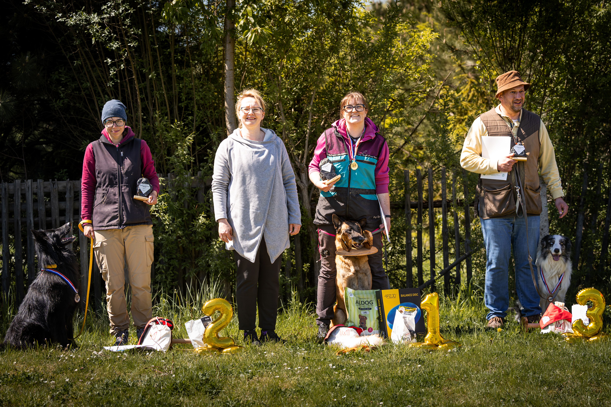
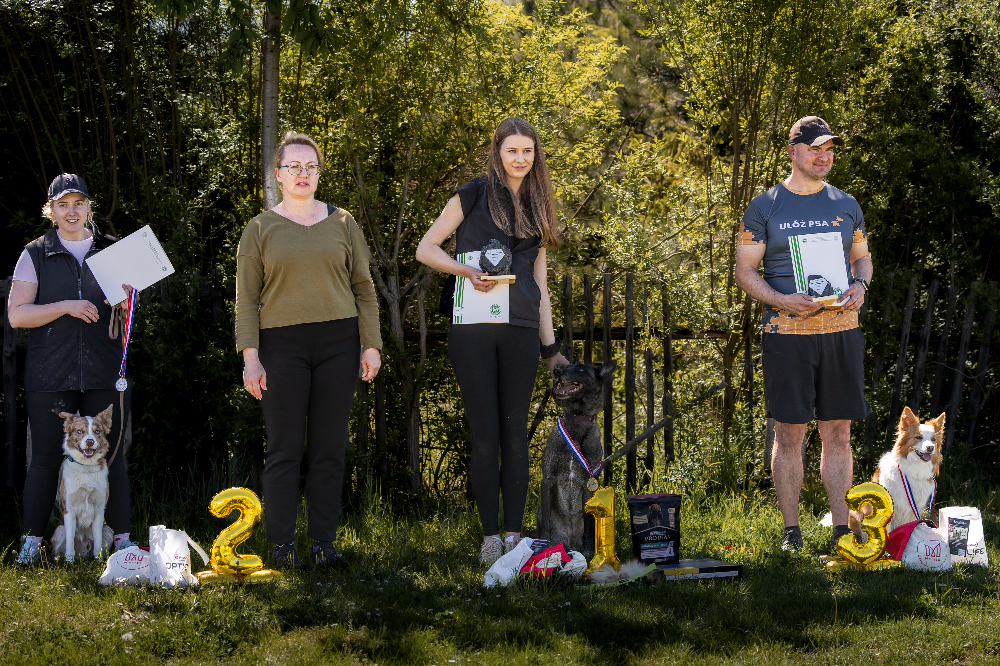
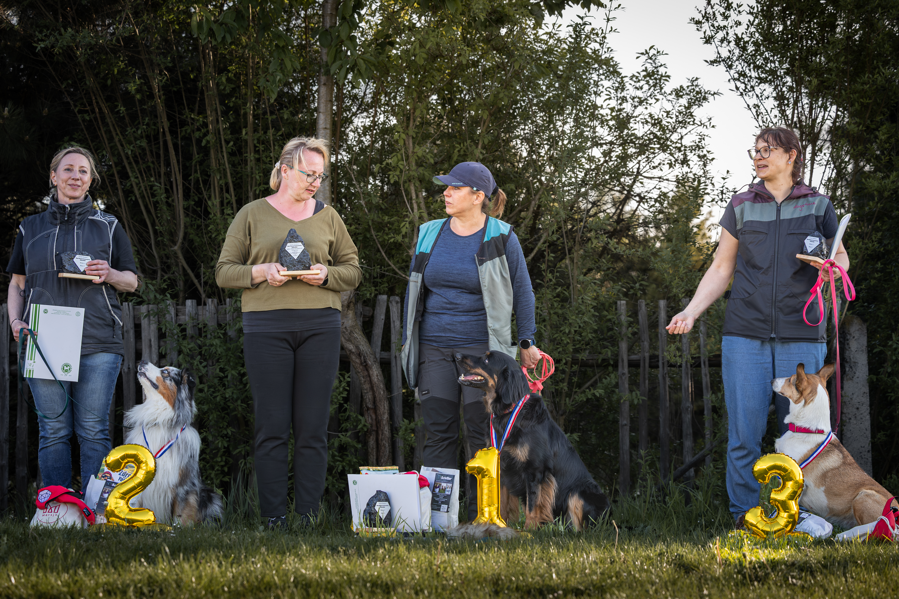

## 📍 Miejsce zawodów

Bytom, boisko sportowe (trawa) klubu PTS Rodło Górniki.

## 👥 Zespół zawodów

- **Organizator**: Magdalena Grzybalska / Oddział ZKwP Zabrze
- **Sędzia**: Małgorzata Kędziorek
- **Komisarz**: Marta Biniaś
- **Kierownik zawodów**: Wiktoria Mrózek

## ℹ️ Informacje organizacyjne

- **Opłata startowa**: 140 zł
- **Liczba miejsc startowych**: 25 zespołów
- **Rejestracja**: Formularz zgłoszeniowy

## 🏆 Wyniki zawodów

### KLASA 2

1. Patrycja Binkowska / Junior Patriot Balkan Kawai Kaito — 258,5 pkt / doskonała
2. Małgorzata Chołoniewska / Nicima's Duke Eskel — 246,5 pkt / bardzo dobra
3. Wojciech Olejniczak / Bilbo — 220,5 pkt / dobra
4. Magdalena Grzybalska / Scarlett Australian Spark — 220 pkt / dobra
5. Marta Mączka / Anoubis Aurum Alexandria — 210,5 pkt / dobra
6. Dominika Regulska  / Bad Boy From Havana to Malibu — 202,5 pkt / dobra

### KLASA 1

1. Agata Hernand-Cichoń / Yapsi vom Haus Seiffert — 296 pkt / doskonała
2. Agnieszka Balicka / Send Me On My Way Border Song — 295,5 pkt / doskonała
3. Mateusz Karcz / Missy Le Monde d’Alexa — 267 pkt / doskonała
4. Iwona Feliksiewicz / Gaspar z Gazdówki — 266,5 pkt / doskonała
5. Natalia Lecińska / Crazy Quick Qualand — 256,5 pkt / doskonała
6. Agnieszka Grabka / PIA Poezja Ruchu — 236,5 pkt / bardzo dobra
7. Karolina Sobolewska / HP Deathly Hallows Imaginings — 226,5 pkt / bardzo dobra
8. Marika Zaborska / Choose Your Way JAKE — 168,5 pkt / bez oceny
Marzena Delong / Dollbabies Pepsi Party All The Time — nieobecna

### KLASA 0

1. Katarzyna Rożniewska / ENERGY Teresie Bohemia — 135,5 pkt / doskonała
2. Kinga Bykowska / Baster It's My Dreamland (FCI) — 124,5 pkt / doskonała
3. Beata Kurek / Dorodna Dynia Smooth Craft — 122,5 pkt / doskonała
4. Roksana Malerowicz-Szultka / Loki Moonlit Wonder Color Joy — 116,5 pkt / doskonała
5. Anna Łuckiewicz / VIKINGS' SPIRIT Australian Spark — 116,5 pkt / doskonała
6. Małgorzata Młynarska / Valkiria Australian Spark — 116 pkt / doskonała
7. Karolina Mrzygłód / Qualand CAN'T HOLD US — 115 pkt / doskonała
8. Michał Obrębski / Xenon Grand Canyon — 112,5 pkt / doskonała
9. Hanna Derek / Aurora Border Collie Luna — 112,5 pkt / doskonała
10. Eliza Wieczorek / Grappa Twelve Moons — 112 pkt / doskonała
11. Marta Wieczorek / Bucky — 99 pkt / bardzo dobra
12. Beata Czekaj / Frugo — 88 pkt / dobra
13. Marzena Pawłowska / Baloo Euphoria Aussie — 79 pkt / dobra
Agnieszka Grabka / NEFRI Poezja Ruchu — nieobecna

## 🔗 Przydatne linki

- [Wydarzenie na Facebooku](https://www.facebook.com/events/25851475981148140/)